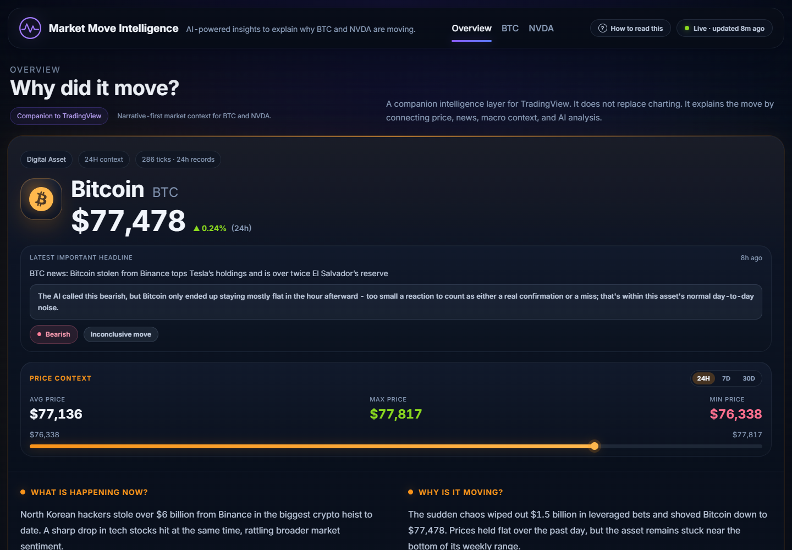
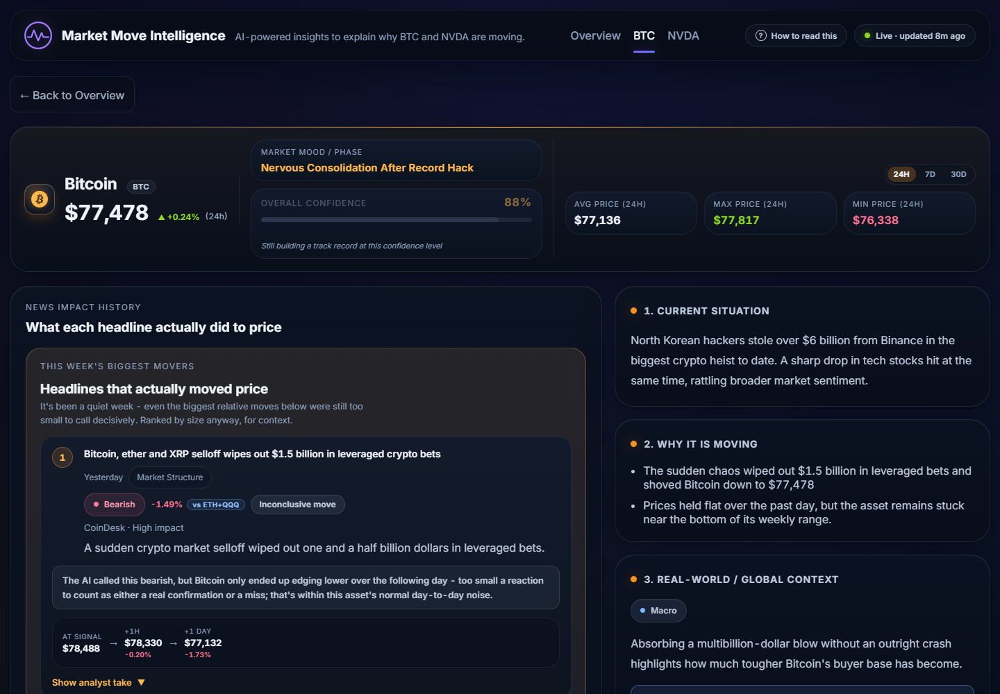

# Market Move Intelligence

**A news-impact intelligence layer for Bitcoin and NVIDIA - built to explain *why* the price moved, not just that it did.**

Most tools show you a price chart. This one is a companion to charting tools like TradingView: it reads every piece of market-moving news for BTC and NVDA, measures what price actually did afterward, and turns that into one honest, plain-English read of the current situation - confidence, risk, track record, and all.



## Why this exists

Reading financial news is easy. Knowing whether it actually *mattered* is not. This project tries to close that gap by doing three things most dashboards don't:

- **It measures, not just reports.** Every headline gets its real 1-hour and next-day price reaction attached to it, adjusted against a sector benchmark (SOX for NVDA, an ETH+QQQ blend for BTC) so a broad market rally isn't mistaken for one story's own effect.
- **It grades its own calls.** An AI track record tracks how often the system's Bullish/Bearish reads have actually held up - including an honest calibration check on whether its *stated* confidence means anything (so far: not reliably).
- **It writes for a human, not an analyst.** No unexplained jargon, no raw data dumps - every section ends in a plain-language verdict, with the supporting numbers available on hover for anyone who wants them.



## What this is **not**

- Not a charting tool - it deliberately doesn't replace TradingView, it reads alongside it.
- Not trading advice - there are no buy/sell signals anywhere in this project, by design.
- Not a price predictor - it explains what already happened and how reliable the AI's read of it has been, nothing more.

## How it works

```
News sources (RSS feeds)          Live prices + macro data
        |                                   |
        v                                   v
   n8n workflow  --->  Gemini (classification + synthesis)  --->  SQL Server
        |                                                           |
        |                                                           v
        |                                                  FastAPI backend
        |                                                           |
        +------------------ scheduled, every 3 min -----------------+
                                                                      |
                                                                      v
                                                          React dashboard (this repo)
```

1. An **n8n workflow** (not included in this repo - it's tied to personal infrastructure) pulls fresh headlines from a dozen+ RSS feeds, dedupes them, and sends each one to **Gemini** for classification (sentiment, importance, category) and - periodically - a synthesized "state of the asset right now" read across the last 48 hours of signals.
2. Real price ticks (collected independently every 10 minutes) and macro indicators (S&P 500, Nasdaq, VIX, Treasury yields) land in **SQL Server** alongside the AI's output.
3. A **FastAPI backend** (`backend/`) measures each headline's actual price reaction against the real price history, computes benchmark-adjusted moves, and aggregates everything into a track record.
4. This **React frontend** renders all of it as one coherent, honest read per asset - never a raw number without a sentence explaining what it means.

## Features

- Per-asset overview with a live "what's happening right now" synthesis
- Full news-impact history: every headline, its real 1h/24h price reaction, and whether the AI's call was confirmed, went against it, or was inconclusive
- "This week's biggest movers" - ranked by actual measured impact, not how loud the headline sounded
- An AI track record with an honest confidence-calibration check (is the AI's stated confidence actually predictive?)
- A macro-context read that compares each asset's move against the broader market in plain language, not a wall of index numbers
- A "new since your last visit" indicator and a first-time-visitor "how to read this" explainer

## Running it locally

There's no live demo (the backend depends on a locally-hosted SQL Server), so this is a clone-and-run project. The screenshots above are real, current output from a live local run.

**Frontend**
```bash
npm install
cp .env.example .env   # only needed if your backend runs somewhere other than localhost:5146
npm run dev
```

**Backend** - see [`backend/README.md`](backend/README.md) for the full setup (Python venv, SQL Server connection, endpoint list).

The frontend expects the `vw_Dashboard_*` SQL views and `Market_Signals`/`Market_Mood`/`Market_Prices`/`Macro_Indicators` tables the backend reads from to already be populated - without the n8n pipeline and price collectors running, the dashboard will load but show no data.

## Tech stack

**Frontend:** React 18, Vite, hand-written CSS (no component library)
**Backend:** FastAPI, pyodbc, SQL Server
**Data pipeline:** n8n, Google Gemini, RSS feeds
**Verification:** Playwright (manual end-to-end checks during development, not an automated CI suite yet)

## License

All rights reserved. This repository is shared publicly for portfolio and demonstration purposes - feel free to read through it, but it isn't licensed for reuse or redistribution.
